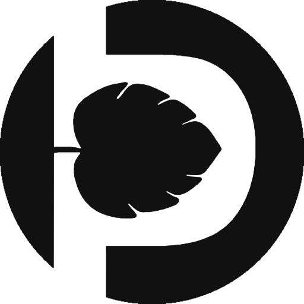

  

<h1 align="center">Petiole</h1>

  Measure plants in photos: leaf area and more, from a phone or from your code.

  <a href="https://petiole.pro">Website</a> ·
  <a href="https://platform.petiole.pro">Platform</a> ·
  <a href="https://petiole.pro/research/">Research</a> ·
  <a href="https://petiole.pro/blog/">Blog</a> ·
  <a href="https://www.linkedin.com/company/petiole/">LinkedIn</a> ·
  <a href="https://x.com/petioleapp">X</a> ·
  <a href="https://www.youtube.com/@petiolepro">YouTube</a>

## The Petiole Platform

Send a photo of leaves on the calibration pad and get back each leaf, its
outline and its area in cm². Run a **workflow**, such as Leaf area, for
measurements with their units, or a single **model**, such as the leaf
detector, for what it finds in the request. Everything the platform does
is an API call: the same one from the [platform app](https://platform.petiole.pro),
a script or a phone.

Access is by invitation for now: [ask for access](https://petiole.pro/company/contact/).

## Open source

**Starters**: small, complete apps on the Petiole API to copy and build
on, under the MIT licence. Each takes your API key, sends a photo and
shows what came back, drawn on it. Model predictions and workflows, for
the web, Python, mobile and desktop. The first,
`petiole-starter-react-predictions`, is on its way.

**SDKs** for Python and TypeScript follow.

## Research

Petiole's measurements are used in plant science, and the papers that
used them are on [petiole.pro/research](https://petiole.pro/research/).

## Contributing and security

Issues and pull requests are welcome on every public repository: see
[CONTRIBUTING](https://github.com/getpetiole/.github/blob/main/CONTRIBUTING.md).
Report a vulnerability privately, never in an issue: see
[SECURITY](https://github.com/getpetiole/.github/blob/main/SECURITY.md).

Petiole® and Petiole Pro® are registered trademarks of Petiole LTD.
